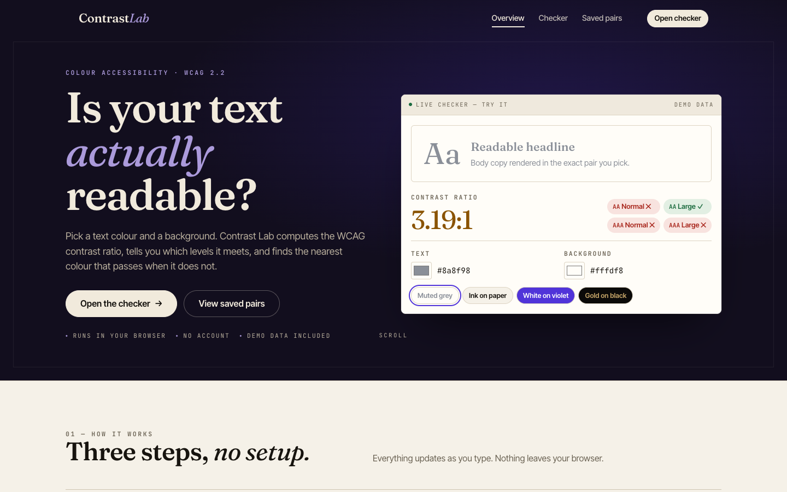
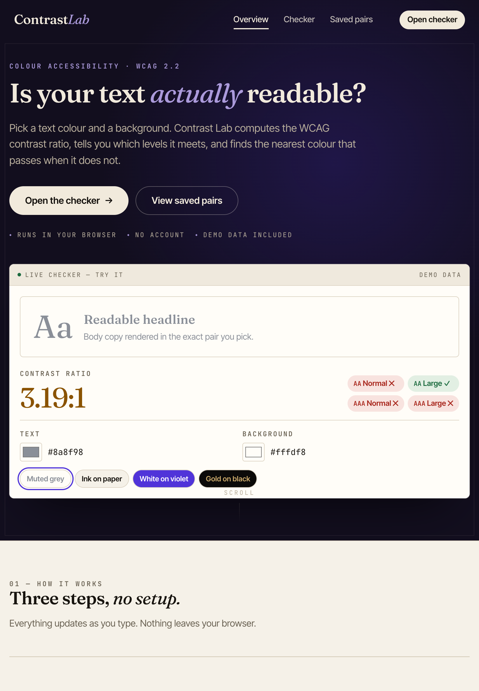
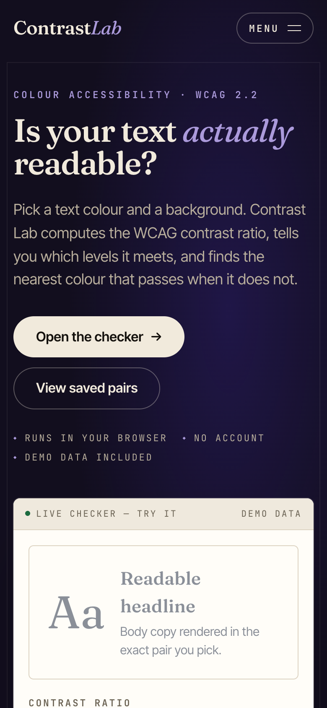
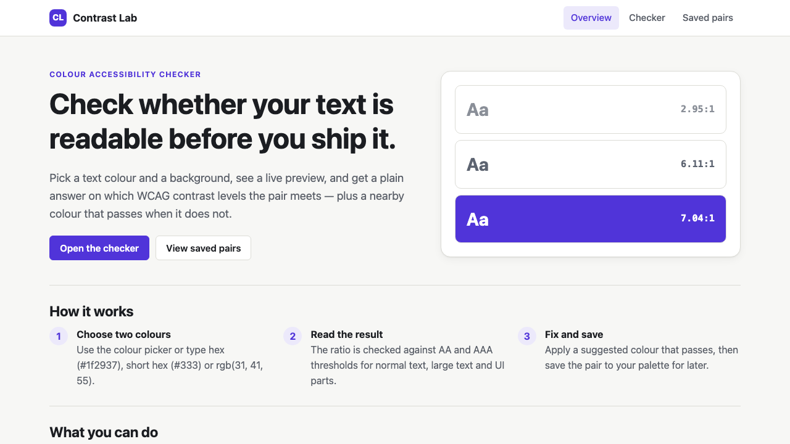
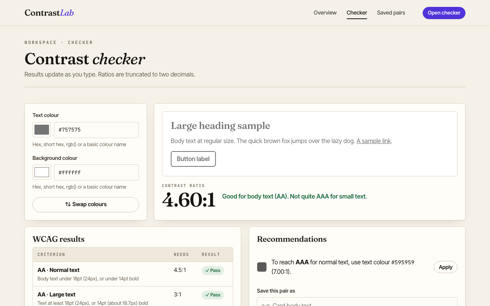
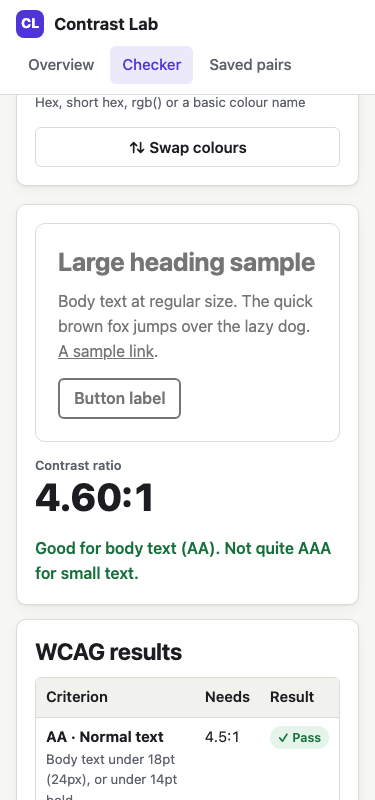

# Contrast Lab

<!-- screenshots:start -->
<p align="center">
  
</p>
<p align="center">
  
  &nbsp;&nbsp;
  
</p>
<p align="center"><sub>Mac (1440×900) · Tablet (820×1180) · Phone (390×844)</sub></p>
<!-- screenshots:end -->

Check a text colour against a background colour using the WCAG 2.x contrast formula, see a live preview, and get a nearby colour that passes when the pair falls short.

**Live demo:** [https://kavishtolani.github.io/contrast-lab/](https://kavishtolani.github.io/contrast-lab/) — runs entirely in your browser; demo data is fictional and labelled.





| Mobile | Landing |
| --- | --- |
|  |  |

## Run it

```bash
npm install
npm run dev        # http://localhost:5101
npm test           # unit + component workflow tests (Vitest)
npm run build      # type-check and production build
npm run test:e2e   # Playwright smoke test against the production build
```

The smoke test needs a Chromium build for Playwright; run `npm run e2e:install` once if it is missing.

## Main workflow

1. Open **Checker**. Type or pick a text colour and a background colour (hex, short hex, `rgb()` or a basic colour name).
2. Read the contrast ratio, the verdict and the pass/fail table for AA and AAA (normal text, large text, UI components).
3. If the pair fails, press **Apply** on a recommendation. It keeps the hue and saturation and changes only lightness.
4. Name the pair and **Save pair**. It appears under **Saved pairs**, where you can reopen or delete it.


Demo content: the palette opens with six labelled demo pairs (including a long name, a failing placeholder pair and an identical-colours 1:1 edge case). **Clear demo pairs** shows the empty state.

## Design

Shared editorial system (Fraunces display, Inter Tight UI, mono labels). The hero preview *is* a working checker: pick colours or presets and the ratio and AA/AAA badges update live.

## States covered

- Validation: unrecognised colour values, empty / duplicate / over-long pair names.
- Success: confirmation after saving or loading demo pairs.
- Empty state: no saved pairs yet.
- Warning: when no lightness of the chosen hue can reach AA on the chosen background.

## How it is built

- React 19 + TypeScript + Vite, plain CSS.
- `src/lib/contrast.ts` holds all colour maths (parsing, relative luminance, contrast ratio, WCAG thresholds, suggestion search).
- Ratios are truncated to two decimals, never rounded up, so a 4.499:1 pair is not shown as passing.
- Data is kept in `localStorage` under `contrast-lab:*` keys.

## Tests

- `src/lib/contrast.test.ts` — parsing, known ratios (21:1, 1:1, #777 on white), threshold evaluation, suggestion search.
- `src/App.test.tsx` — landing render, check → validation → apply fix → save, empty state and demo data.
- `e2e/smoke.spec.ts` — full browser workflow, reload persistence, no horizontal scroll at 375px; writes the screenshots above.

## Limitations

- Uses WCAG 2.x contrast only. APCA (proposed for WCAG 3) is not implemented.
- Does not handle transparent colours, gradients or text over images.
- Suggestions only vary the text colour, not the background.
- The colour-name list is deliberately small (12 names).

## Future improvements

- Add APCA scores alongside WCAG 2.x.
- Suggest background adjustments and full palette checks (every text colour against every background).
- Export saved pairs as CSS custom properties or JSON.

## Licence

MIT — see [LICENSE](LICENSE).
